<picture>
  <source media="(prefers-color-scheme: dark)" srcset="./assets/banner-dark.svg" />
  <source media="(prefers-color-scheme: light)" srcset="./assets/banner-light.svg" />
  
</picture>

 

  
  
  

---

### 👨‍💻 About Me

- 🎓 **Information Technology undergraduate** at **Ho Chi Minh City University of Technology and Education (HCMUTE)**, focused on shipping practical, end-to-end software and applied AI products.
- 🧠 **Applied AI & Retrieval Engineering:** Designing grounded **RAG pipelines** (`FAISS`, `MMR`, `Cohere Rerank`) with page-level citations and prompt-injection guardrails, alongside ongoing research in **Medical Visual Question Answering (MedVQA)**.
- ⚙️ **Backend & Local-First Systems:** Building transactional REST & realtime services with **Python (`FastAPI`)** and **Java (`Spring Boot 4`)**, plus zero-friction desktop/browser tools backed by **`AES-256-GCM`** encryption and **`SQLite FTS5`**.
- 📫 **Reach me at:** [`23110170@student.hcmute.edu.vn`](mailto:23110170@student.hcmute.edu.vn) — currently open to **Software Engineering / Backend / AI Engineering Internships** in Ho Chi Minh City.

---

### 🚀 Featured Engineering Projects

<table>
  <tr>
    <td width="50%" valign="top">
      <h4><a href="https://github.com/Tuong2608/job-clipper">⚡ Job Clipper — CV Studio</a></h4>
      
<b>Cross-Device AI Job Tracker &amp; ATS Resume Builder</b>

      
Captures job descriptions across desktop &amp; mobile via a <b>Chrome MV3 Extension</b> and <b>LAN QR Offline Queue</b>, evaluates JD–CV alignment without hallucinating skills, and exports ATS-ready A4 <code>.docx</code> / <code>.pdf</code> resumes from a lightweight Windows System Tray app.

      
<code>Python</code> <code>FastAPI</code> <code>SQLite FTS5</code> <code>Chrome MV3</code> <code>JavaScript</code>

    </td>
    <td width="50%" valign="top">
      <h4><a href="https://github.com/Tuong2608/personal-inbox">🔐 Bãi Đáp — Personal Inbox &amp; Vault</a></h4>
      
<b>Local-First Workspace &amp; Zero-Knowledge Secret Vault</b>

      
Self-hosted personal dropzone combining client-side <b>AES-256-GCM encryption</b>, Vision OCR for screenshots, automated AI tagging, accent-insensitive Vietnamese search, and <b>Cohere rerank-v3.5</b> semantic retrieval.

      
<code>Python</code> <code>AES-256-GCM</code> <code>Vision OCR</code> <code>Cohere Rerank</code> <code>MV3 Extension</code>

    </td>
  </tr>
  <tr>
    <td width="50%" valign="top">
      <h4><a href="https://github.com/Tuong2608/sope-backend">🛍️ SOPE E-Commerce Backend</a></h4>
      
<b>Transactional RESTful API &amp; Realtime Order Core</b>

      
Core e-commerce backend featuring <b>JWT + Google OAuth2</b> RBAC, variant inventory, cart &amp; coupon workflows, <b>VNPay &amp; MoMo</b> payment integration, <b>WebSocket/STOMP</b> live order notifications, and a privacy-preserving AI chatbot proxy.

      
<code>Java</code> <code>Spring Boot 4</code> <code>MySQL</code> <code>JWT / OAuth2</code> <code>WebSocket</code> <code>Docker</code>

    </td>
    <td width="50%" valign="top">
      <h4><a href="https://github.com/Tuong2608/local-pdf-knowledge-base">📄 Local PDF Knowledge Base</a></h4>
      
<b>Citation-Backed Grounded RAG Application</b>

      
Retrieval-Augmented Generation pipeline built with page-aware recursive chunking, <b>Gemini embeddings</b>, local <b>FAISS</b> vector search, and <b>Maximal Marginal Relevance (MMR)</b> to deliver strictly grounded answers with expandable page citations and prompt-injection defense.

      
<code>Python</code> <code>RAG</code> <code>FAISS</code> <code>Gemini API</code> <code>MMR</code> <code>Streamlit</code>

    </td>
  </tr>
  <tr>
    <td width="50%" valign="top">
      <h4><a href="https://github.com/Tuong2608/LTDDNC">🏠 Trọ An — Rental Management Suite</a></h4>
      
<b>Cross-Platform Mobile App &amp; Dart REST Backend</b>

      
Full-lifecycle boarding-house management &amp; utility billing platform combining a <b>Flutter</b> mobile client, <b>Dart</b> backend API, <b>MySQL</b> core persistence, offline <b>Sqflite</b> meter drafts, and <b>Firebase</b> (Auth, Firestore live chat, FCM, Crashlytics).

      
<code>Flutter</code> <code>Dart</code> <code>MySQL</code> <code>Sqflite</code> <code>Firebase</code>

    </td>
    <td width="50%" valign="top">
      <h4><a href="https://github.com/Tuong2608/Git-Health-Monitor">📊 Git Health Monitor</a></h4>
      
<b>Full-Stack Repository Telemetry &amp; Analytics Platform</b>

      
Tracks repository snapshots, scheduled inspection jobs, and code-health alerts through a <b>Java 21 + Spring Boot 4</b> backend with <b>PostgreSQL 18 (Flyway)</b> migrations and a modern <b>React 19 + TypeScript + Recharts</b> web dashboard.

      
<code>Java 21</code> <code>Spring Boot 4</code> <code>PostgreSQL</code> <code>React 19</code> <code>TypeScript</code> <code>Docker</code>

    </td>
  </tr>
</table>

---

### 🛠️ Tech Stack & Tooling

<table>
  <tr>
    <td align="center" width="33%"><b>Languages</b></td>
    <td align="center" width="34%"><b>Backend, AI &amp; Databases</b></td>
    <td align="center" width="33%"><b>Frontend, Mobile &amp; DevOps</b></td>
  </tr>
  <tr>
    <td align="center">
      <picture>
        <source media="(prefers-color-scheme: dark)" srcset="https://skillicons.dev/icons?i=py,java,ts,js,dart,cpp,html,css&perline=4&theme=dark" />
        <source media="(prefers-color-scheme: light)" srcset="https://skillicons.dev/icons?i=py,java,ts,js,dart,cpp,html,css&perline=4&theme=light" />
        
      </picture>
    </td>
    <td align="center">
      <picture>
        <source media="(prefers-color-scheme: dark)" srcset="https://skillicons.dev/icons?i=fastapi,spring,postgres,mysql,sqlite,firebase,pytorch&perline=4&theme=dark" />
        <source media="(prefers-color-scheme: light)" srcset="https://skillicons.dev/icons?i=fastapi,spring,postgres,mysql,sqlite,firebase,pytorch&perline=4&theme=light" />
        
      </picture>
    </td>
    <td align="center">
      <picture>
        <source media="(prefers-color-scheme: dark)" srcset="https://skillicons.dev/icons?i=react,nextjs,flutter,tailwind,vite,docker,git,githubactions&perline=4&theme=dark" />
        <source media="(prefers-color-scheme: light)" srcset="https://skillicons.dev/icons?i=react,nextjs,flutter,tailwind,vite,docker,git,githubactions&perline=4&theme=light" />
        
      </picture>
    </td>
  </tr>
</table>

---

### 📈 Engineering Activity & Contribution Graph

<picture>
  <source media="(prefers-color-scheme: dark)" srcset="https://github-profile-summary-cards.vercel.app/api/cards/profile-details?username=Tuong2608&theme=github_dark" />
  <source media="(prefers-color-scheme: light)" srcset="https://github-profile-summary-cards.vercel.app/api/cards/profile-details?username=Tuong2608&theme=default" />
  
</picture>

 

<picture>
  <source media="(prefers-color-scheme: dark)" srcset="https://streak-stats.demolab.com?user=Tuong2608&theme=github-dark-blue&hide_border=true&border_radius=8" />
  <source media="(prefers-color-scheme: light)" srcset="https://streak-stats.demolab.com?user=Tuong2608&theme=default&hide_border=true&border_radius=8" />
  
</picture>
&nbsp;
<picture>
  <source media="(prefers-color-scheme: dark)" srcset="https://github-profile-summary-cards.vercel.app/api/cards/repos-per-language?username=Tuong2608&theme=github_dark" />
  <source media="(prefers-color-scheme: light)" srcset="https://github-profile-summary-cards.vercel.app/api/cards/repos-per-language?username=Tuong2608&theme=default" />
  
</picture>

  

<picture>
  <source media="(prefers-color-scheme: dark)" srcset="./assets/github-contribution-grid-snake-dark.svg" />
  <source media="(prefers-color-scheme: light)" srcset="./assets/github-contribution-grid-snake.svg" />
  
</picture>

